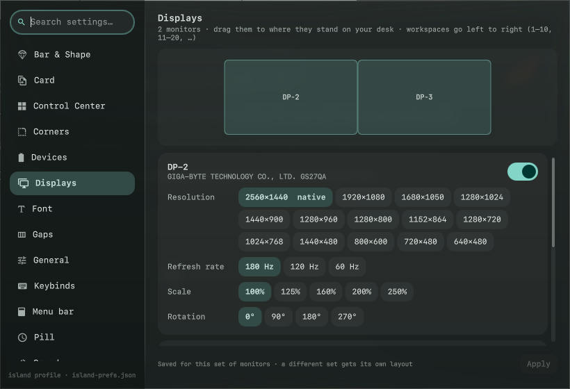
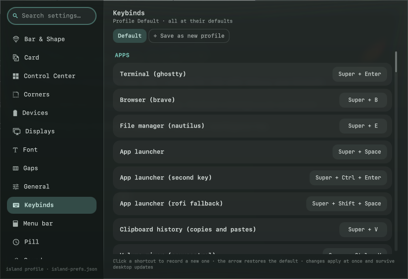

# arch-hyprland

A ready-to-use Hyprland desktop for Arch Linux: a menu bar with a dynamic
island, a control center, a dock, notifications, a lock screen, and a colour
scheme that follows your wallpaper. It installs with one command and sets
itself up for your monitors.


<table>
  <tr>
    <td></td>
    <td></td>
  </tr>
  <tr>
    <td align="center">Settings → Displays</td>
    <td align="center">Settings → Keybinds</td>
  </tr>
</table>

**What you get:** Brave, Telegram, Discord, Spotify, Claude Desktop, VLC,
a file manager, screenshots (Flameshot) and screen recording (GPU Screen
Recorder), plus Steam with gamemode and LibreOffice with printing, both
optional.

---

## Install

On a fresh Arch install, logged in as your normal user:

```bash
sudo pacman -S --needed git
git clone https://github.com/Graggorr/arch-hyprland.git ~/arch-hyprland
cd ~/arch-hyprland
./install.sh
```

Options:

| | |
|---|---|
| `./install.sh --no-gaming` | without Steam and the gaming tools |
| `./install.sh --no-office` | without LibreOffice and printing |
| `./install.sh --no-updates` | without automatic updates (see [Updates](#updates)) |

When it finishes, log out and choose **Hyprland (uwsm-managed)** on the login
screen.

---

## First steps

- `Super + /` shows every keyboard shortcut.
- `Super + W` picks a theme and wallpaper; the whole desktop recolours to match.
- `Super + S` opens Settings.
- Sign in to the apps you use (Brave, Telegram, Discord, Spotify, Claude).

---

## Everyday keys

| Key | Action |
|---|---|
| `Super + Enter` | terminal |
| `Super + Space` | app launcher |
| `Super + B` / `Super + E` | browser / files |
| `Super + V` | clipboard history |
| `Super + Q` | close window |
| `Super + F` / `Super + M` / `Super + T` | fullscreen / maximize / float |
| `Super + 1…0` | switch workspace |
| `Super + Shift + 1…0` | move the window to a workspace |
| `Super + L` | lock |
| `Super + End` | log out |
| `Print` / `Super + Print` | copy an area / screenshot editor |
| `Alt + Z` | screen recorder |
| `Alt + '` / `Alt + I` / `Alt + P` | Discord mute / deafen / go live |

Each monitor has its own ten workspaces: the left one 1–10, the next 11–20,
and so on.

---

## Settings

Open with `Super + S`. Every change applies immediately.

### Keybinds

Every shortcut, grouped by app. Click a shortcut and press the new keys.

- `Esc` cancels, `Backspace` removes the shortcut, and the arrow brings back
  the original.
- Two actions on the same keys are marked in red.
- **Profiles**: **Save as new profile** keeps the current set under a name.
  Click a profile to switch to it; the × deletes it. **Default** is the set
  you started with.

### Displays

Your monitors are set up automatically, at their best resolution and refresh
rate, and again whenever you plug one in. To adjust:

- Drag the monitors to match how they stand on your desk.
- Pick resolution, refresh rate, scale and rotation per monitor, or switch
  one off.
- Press **Apply**, then **Keep**. If you don't confirm within 15 seconds (for
  example because a screen went black), the old settings come back.

### General

Shell style, dock, menu bar, silent mode, clock format and automatic updates.
The other sections tune the bar, island, dock, fonts, gaps and sound.

---

## Discord

Mute, deafen and go live work from anywhere with the keys above, as long as
Discord was started from the app launcher or the dock.

To also see your Discord call status in the island, create a free Discord
application at <https://discord.com/developers/applications> (add
`http://localhost` as an OAuth2 redirect), then run:

```bash
echo '{"client_id":"<your application id>"}' > ~/.config/quickshell/discord-rpc.json
secret-tool store --label='Discord RPC' service discord-rpc key client_secret   # paste the client secret
python3 ~/.config/quickshell/scripts/discord-rpc.py auth                        # approve in Discord
```

---

## Calendar

The island shows your Google or iCloud calendar and Google Tasks. To connect
your accounts, run the guided setup and turn on syncing:

```bash
calendar-setup
systemctl --user enable --now vdirsyncer.timer
```

`calendar-subscribe` adds public calendars by URL (holidays, sports).

---

## Personal touches

- **Keyboard layouts:** `kb_layout` in `~/.config/hypr/hyprland.lua`
  (default `"us,ua"`, switch with Ctrl + Shift).
- **Weather city:** `wxCity` in `~/.config/quickshell/IslandState.qml`
  (default `kyiv`).
- **Apps that start at login:** `~/.config/hypr/scripts/workspace-apps.sh`.

Your changes are kept when the desktop updates.

---

## Updates

The desktop checks this repo for improvements every hour and applies them
without touching your own changes. Apps update with the system (`yay -Syu`).

Turn updates off in **Settings → General → Desktop updates**, or:

```bash
~/arch-hyprland/update.sh --off      # stop automatic updates
~/arch-hyprland/update.sh --on       # start them again
~/arch-hyprland/update.sh            # update right now
```

---

## Make it your own

Fork this repo on GitHub and point your copy at the fork:

```bash
git -C ~/arch-hyprland remote set-url origin https://github.com/<you>/arch-hyprland.git
```

Updates then come from your fork: change files under `desktop/`, push, and
every machine installed from it follows. To pull in improvements from here
later:

```bash
git -C ~/arch-hyprland remote add upstream https://github.com/Graggorr/arch-hyprland.git
git -C ~/arch-hyprland pull upstream main
```
